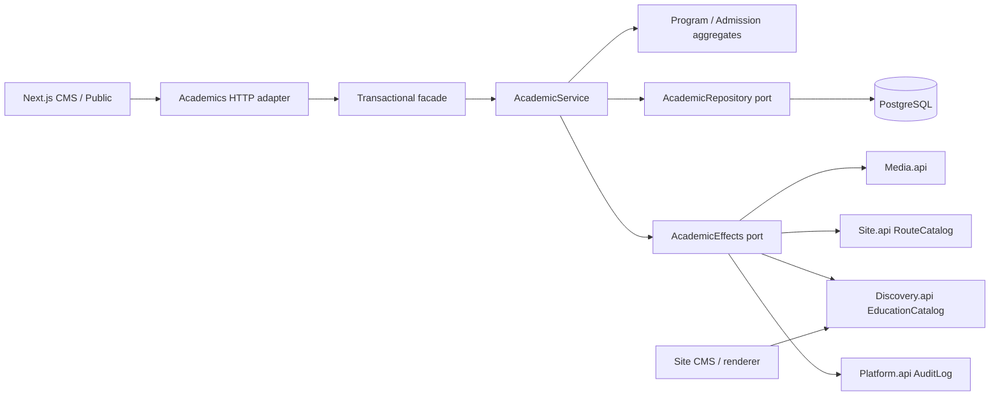

# Đào tạo và tuyển sinh

## Phạm vi

Module Academics quản lý chương trình đào tạo và các đợt tuyển sinh trong cùng Spring Boot API. CMS và website công khai thuộc cùng Next.js App Router. Không có bước duyệt bài: **Lưu và công khai** áp dụng nội dung ngay sau khi giao dịch thành công.

| Màn hình               | URL local Docker                                                              |
| ---------------------- | ----------------------------------------------------------------------------- |
| CMS chương trình       | http://localhost:8088/admin/programs                                          |
| CMS tuyển sinh         | http://localhost:8088/admin/admissions                                        |
| Chương trình công khai | http://localhost:8088/vi/dao-tao                                              |
| Tuyển sinh công khai   | http://localhost:8088/vi/tuyen-sinh                                           |
| Trang chủ / menu       | http://localhost:8088/admin/site/home · http://localhost:8088/admin/site/menu |

Các route public hỗ trợ `vi` và `en`. Mỗi nội dung có ngôn ngữ riêng; chưa có chức năng ghép và quản lý bản dịch. Bộ seed từ nguồn chính thức và các điểm cần đối chiếu: [Nhập nguồn](reference-import.md).

## Cách kiểm tra từ CMS

### Chương trình đào tạo

1. Đăng nhập bằng tài khoản **ADMIN** hoặc **EDITOR**, mở **Chương trình đào tạo → Tạo chương trình**.
2. Chọn mã, ngôn ngữ và bậc học. Ba thuộc tính này được giữ cố định; mã duy nhất trong cùng ngôn ngữ.
3. Hồ sơ mới đi theo 5 bước: **Thông tin chung → Đầu ra & nghề nghiệp → Khung chương trình → Kiểm định → Liên hệ**. Nhập tên, slug, tóm tắt, giới thiệu, văn bằng và đơn vị; thêm từng chuẩn đầu ra/cơ hội nghề nghiệp bằng nút **Thêm**. Hồ sơ đã có có thể mở trực tiếp bất kỳ tab nào.
4. Trong **Khung chương trình**, thêm phiên bản, khóa áp dụng, ngày hiệu lực; cung cấp học phần hoặc URL HTTPS của tài liệu. Mỗi khóa chỉ có một khung được chọn hiện hành.
5. Trong **Kiểm định**, nhập chứng nhận, tổ chức, ngày cấp và URL minh chứng. Ngày hết hạn tùy chọn; thiếu ngày này sẽ hiển thị “Chưa ghi ngày hết hạn”.
6. Chọn ảnh qua thư viện chung, có mô tả ảnh. Có thể **Lưu nháp** và **Xem trước** trong khi nhập; nút **Lưu và công khai** xuất hiện ở bước cuối khi tạo mới.
7. Mở **Xem bản công khai**. Sửa và lưu nháp không thay bản người đọc đang thấy.
8. **Lịch sử** cho phép khôi phục một phiên bản vào nháp. **Ngừng công khai** cần lý do và bị chặn khi còn đợt tuyển đang/sắp mở hoặc thông báo chưa xác định hạn kết thúc.
9. **Khôi phục về nháp** mở lại quyền biên tập; cần công khai lần nữa để hiện trên website.

Khung đào tạo và chứng nhận nằm trong snapshot của chương trình, có ID riêng. Lịch sử lưu cả danh sách học phần và minh chứng của từng lần công khai. Tổng tín chỉ học phần kê khai được hiển thị riêng, không tự coi đó là tổng tín chỉ bắt buộc của chương trình.

### Tuyển sinh

1. Công khai ít nhất một chương trình trước, sau đó chọn **Tuyển sinh → Tạo đợt tuyển**.
2. Nhập thông báo và năm tuyển; chọn chương trình cùng ngôn ngữ và bậc học. Chỉ tiêu từng chương trình là thông tin tùy chọn.
3. Nhập điều kiện dự tuyển, phương thức xét tuyển, URL HTTPS của cổng nộp hồ sơ và liên hệ.
4. Nhập mốc mở/đóng theo **giờ Việt Nam (UTC+07)**; bổ sung các mốc xét tuyển/công bố kết quả.
5. Công khai và mở trang public. Trạng thái được tính từ đồng hồ backend tại mỗi request.
6. **Gia hạn** yêu cầu hạn mới sau hạn cũ và sau thời điểm hiện tại, kèm lý do. Thao tác chỉ cập nhật hạn đóng trên bản công khai; nội dung nháp khác được giữ riêng.
7. **Đóng sớm** dừng trạng thái nhận hồ sơ ngay và hiển thị thông báo/lý do đóng. Trang vẫn đọc được, nút nộp hồ sơ được ẩn.
8. **Gỡ công khai** ẩn trang và kết quả tìm kiếm; giữ bản nháp và lịch sử.

| Trạng thái   | Điều kiện                                       |
| ------------ | ----------------------------------------------- |
| NOTICE       | Thiếu một/cả hai mốc; chưa qua hạn đóng đã biết |
| UPCOMING     | Đủ mốc, chưa đóng sớm và hiện tại trước mốc mở  |
| OPEN         | Chưa đóng sớm và mở ≤ hiện tại < đóng           |
| CLOSED       | Chưa đóng sớm và hiện tại ≥ mốc đóng            |
| CLOSED_EARLY | Đã có quyết định đóng sớm                       |

Mốc đóng là cận trên loại trừ. Muốn nhận hồ sơ hết ngày 28/8, nhập **00:00 ngày 29/8**. Database lưu UTC. Không cần cron để chuyển trạng thái.

Đợt hết hạn tự nhiên có thể gia hạn khi các chương trình vẫn công khai. Đợt đã đóng sớm không được gia hạn; tạo đợt mới nếu tuyển lại. Khi khôi phục lịch sử của một đợt đang công khai, mốc đăng ký và trạng thái đóng sớm hiện tại được giữ nguyên.

Đợt đã kết thúc vẫn lưu tên/mã chương trình trong snapshot. Nếu chương trình sau đó ngừng công khai, thông báo cũ giữ nhãn chương trình và bỏ liên kết chi tiết.

## Liên kết trang chủ và menu

- Có bốn loại liên kết mới: danh sách chương trình, danh sách tuyển sinh, chương trình công khai và đợt tuyển công khai.
- Liên kết nội dung được lưu bằng ID. Site lấy slug hiện tại qua `Discovery.api.EducationCatalog`; đổi slug không yêu cầu sửa menu.
- Thẻ trang chủ có loại liên kết **Chương trình công khai** lấy tên/tóm tắt từ bản công khai của chương trình. Nội dung đã ngừng sẽ được ẩn khỏi thẻ và menu.
- Bật khối tuyển sinh trong CMS trang chủ để hiển thị tối đa 6 đợt. Chọn `OPEN` để chỉ lấy đợt đang nhận hồ sơ hoặc `LATEST` để tra cứu thông báo mới nhất, kể cả đã hết hạn.
- Các thẻ/liên kết website cũ đang có vẫn chỉnh được trong CMS. Hệ thống không tự ghi đè cấu hình đã biên tập.
- Footer có đường dẫn đến hai danh sách public.

## Kiến trúc và giao dịch

```text
academics/
  domain/          AcademicProgram, ProgramDraft, CurriculumVersion, Accreditation,
                   AdmissionCampaign, AdmissionDraft, PublicContact, AcademicRules,
                   AcademicResource, SourceReference
  application/     AcademicService điều phối use case và policy liên aggregate
    port/          AcademicRepository, AcademicEffects
  adapters/        HTTP controller, transactional facade, JDBC persistence,
                   JSON codec và adapter gọi API module khác
```

Domain/application thuần Java, không phụ thuộc Spring/JPA/Jackson. Aggregate kiểm tra trạng thái, version, ngày, văn bằng, khóa áp dụng, mốc tuyển sinh và tạo edition bất biến. Application kiểm tra tham chiếu chương trình và điều phối các port.

Các phụ thuộc:



Site đọc projection của Discovery, không gọi ngược nội bộ Academics. ArchUnit kiểm tra dependency giữa module, không có vòng và không import framework vào domain/application.

Một transaction ghi edition, live pointer, quan hệ admission–program, route/alias, quyền đọc ảnh, projection tìm kiếm và audit. `If-Match` bảo vệ optimistic concurrency. Khóa advisory transaction dùng chung cho các mutation Academics ngăn race giữa publish/extend admission và retire program; phù hợp lưu lượng biên tập hiện tại. Khi tăng tải ghi, có thể thay adapter khóa bằng khóa bản ghi theo thứ tự mà giữ policy của application.

Migration `V4__academics.sql` tạo schema Academics, projection education và namespace route. Migration `V5__academic_route_slug_length.sql` đồng bộ giới hạn slug 180 ký tự với registry dùng chung. Khóa đường dẫn là `(locale, namespace, slug)`; cùng slug có thể tồn tại ở bài viết, chương trình và tuyển sinh. Đường dẫn cũ tiếp tục resolve đến ID, Next trả redirect vĩnh viễn về slug hiện tại.

## Quyền và bảo mật

| Vai trò | Academics                                                             |
| ------- | --------------------------------------------------------------------- |
| AUTHOR  | Không truy cập CMS/API quản trị Academics                             |
| EDITOR  | Tạo/sửa/công khai/khôi phục/ngừng chương trình; quản lý các đợt tuyển |
| ADMIN   | Toàn bộ quyền Editor, cùng quyền tài khoản và Site đã có              |

Capability là `academics:manage`. Proxy kiểm tra route hint; DAL và backend kiểm tra phiên/quyền thật. Mutation dùng CSRF và Origin policy hiện tại. V4 tăng authVersion của Admin/Editor hiện có để phiên cũ nhận bộ quyền mới qua lần đăng nhập tiếp theo.

Ảnh dùng MediaCatalog với usage nháp/public độc lập. Ảnh chỉ có trong nháp không đọc được qua API public. URL tài liệu, minh chứng và nộp hồ sơ chỉ nhận HTTPS hợp lệ; nội dung mô tả được render dạng văn bản, không nhận HTML tùy ý.

## Hợp đồng API

Tất cả đường dẫn dưới đây có tiền tố `/api/v1`. `kind` là `programs` hoặc `admissions`.

| Method / route                                               | Chức năng                                                           |
| ------------------------------------------------------------ | ------------------------------------------------------------------- |
| GET /admin/academics/{kind}?q=&locale=&page=&size=           | Danh sách CMS, tìm tên/mã, phân trang                               |
| POST /admin/academics/{kind}                                 | Tạo nháp với code, locale, level; trả 201                           |
| GET /admin/academics/{kind}/{id}                             | Nháp, version, trạng thái, URL công khai hiện tại                   |
| PATCH /admin/academics/{kind}/{id}                           | Lưu toàn bộ payload nháp                                            |
| GET /admin/academics/{kind}/{id}/preview                     | Render model riêng cho bản xem trước                                |
| POST /admin/academics/{kind}/{id}/publish                    | Công khai với draftVersion                                          |
| GET /admin/academics/{kind}/{id}/editions                    | 50 phiên bản công khai gần nhất                                     |
| POST /admin/academics/{kind}/{id}/restore                    | Khôi phục editionId vào nháp                                        |
| POST /admin/academics/programs/{id}/retire                   | Ngừng công khai, body reason                                        |
| POST /admin/academics/programs/{id}/reinstate                | Khôi phục về nháp                                                   |
| POST /admin/academics/admissions/{id}/extend                 | Body deadline (UTC ISO-8601), reason                                |
| POST /admin/academics/admissions/{id}/close                  | Đóng sớm, body reason                                               |
| POST /admin/academics/admissions/{id}/withdraw               | Gỡ thông báo, body reason                                           |
| GET /public/academics/{kind}                                 | q, locale, level, page, size; tuyển sinh thêm status, year, program |
| GET /public/academics/{kind}/{slug}?locale=vi                | Chi tiết bản công khai; không có draft                              |
| GET /public/academics/{kind}/lookup/by-id?locale=vi&ids=UUID | Resolve tối đa 30 nội dung công khai cho bộ chọn liên kết           |

Mutation trên tài nguyên đã tạo yêu cầu header `If-Match: "version"`. Thiếu version trả 428; xung đột 412; trùng mã/slug 409; thiếu quyền 403; vi phạm nghiệp vụ 422; nội dung không công khai/không tồn tại 404. Dữ liệu phân trang giới hạn 50 mục/request. Mỗi lý do thao tác cần 5–1.000 ký tự và được lưu vào audit; gia hạn/đóng sớm còn được lưu trong edition.

Public list chỉ tìm trên projection đã công khai, hỗ trợ tìm tiếng Việt không dấu. Canonical và sitemap gồm các URL hiện hành; chương trình ngừng hoặc đợt gỡ sẽ biến mất khỏi danh sách/sitemap.

## Các giới hạn hiện tại

- Lưu nháp thủ công; cảnh báo khi rời trang và có nút tải JSON dự phòng. Chưa có đồng bộ offline.
- Mô tả dùng đoạn văn/xuống dòng; học phần, kiểm định, điều kiện và lịch trình là trường có cấu trúc.
- Upload hiện nhận ảnh JPG/PNG. Tài liệu khung đào tạo và minh chứng PDF được gắn bằng URL HTTPS; chưa upload PDF trực tiếp.
- Tối đa 20 khung, 150 học phần/khung, 20 chứng nhận/chương trình; 30 chương trình và 30 mốc/đợt tuyển.
- Khung/chứng nhận lưu trong JSONB edition của chương trình; chưa có API phân trang lịch sử từng học phần. CMS hiển thị 50 edition gần nhất.
- Đầu mối là thông tin liên hệ thuộc chương trình/đợt tuyển. Liên kết hồ sơ nhân sự sẽ được bổ sung khi có Directory.
- Nhập dữ liệu chính thức và chuyển nội dung website cũ là giai đoạn tiếp theo.

## Kiểm thử và chạy lại

```bash
npm run typecheck
npm run test:api
docker compose --env-file .env -f infra/compose/compose.yml --profile app up -d --build
docker compose --env-file .env -f infra/compose/compose.yml restart ingress
```

Chờ health API và trang đăng nhập sẵn sàng trước khi chạy trình duyệt. Với Docker, đặt `E2E_BASE_URL=http://localhost:8088`; với hai server native, mặc định là `http://localhost:3000`.

```bash
# Bash
E2E_BASE_URL=http://localhost:8088 npm run test:e2e
```

```powershell
# PowerShell
$env:E2E_BASE_URL = "http://localhost:8088"
npm run test:e2e
```

Backend test dùng PostgreSQL 18.6 riêng qua Testcontainers. E2E chạy CMS/API thật và MinIO của môi trường đang mở; chỉ chạy trên local/test. Danh sách ID tài nguyên do E2E tạo được ghi tại `.runtime/e2e-fixtures.json` để dọn có phạm vi. Các test Site tự khôi phục nội dung ban đầu; không reset database hoặc xóa volume.

Kết quả kiểm tra và trạng thái bản Docker được ghi tại [Trạng thái triển khai](implementation-status.md).

## Dữ liệu nguồn và lịch chưa đầy đủ

Tab thông tin chung có **Tài liệu và nguồn thông tin**: tối đa 20 liên kết HTTPS hoặc bài nội bộ, URL nguồn, ngày đăng và ngày đối chiếu. Chúng nằm trong snapshot và hiển thị trong sidebar public/preview. Ngày đăng nguồn không thay ngày xuất bản edition.

Nguồn thiếu lịch: để trống mốc chưa biết và ghi nguồn trước khi công khai. Trạng thái **Theo thông báo (NOTICE)** không được xem là đang nhận hồ sơ. Nếu đã biết hạn và đã quá hạn thì vẫn hiển thị **Đã hết hạn**. Chỉ thêm được mốc còn thiếu qua sửa nháp; đổi hạn đã biết dùng Gia hạn. Chương trình có thông báo chưa biết hạn cũng không được ngừng công khai.

Home có lựa chọn chỉ đợt đang mở (`OPEN`) hoặc thông báo mới nhất (`LATEST`). Bộ seed dùng `LATEST`. Quy trình và dữ liệu: [Nhập nguồn](reference-import.md).

Bộ nhập toàn văn bổ sung tài liệu **Nội dung bài gốc đầy đủ** cho từng chương trình/thông báo. Bài được quản trị trong Publishing, giữ nội dung lịch sử nguyên bản; các trường nghiệp vụ Academics tiếp tục dùng dữ liệu đã đối chiếu.
