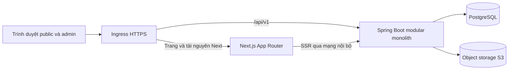
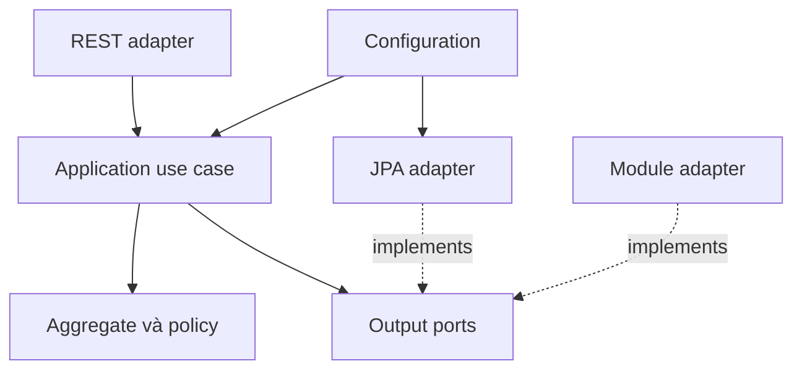

# Kiến trúc hệ thống

## Cấu trúc triển khai

Một frontend Next.js, một backend Spring Boot, một PostgreSQL. Cùng hostname giúp đơn giản hóa cookie, CSRF và cách gọi API.



Ingress chuyển `/api/v1/**` đến backend; các route website đến Next.js. `proxy.ts` của Next.js là lớp kiểm tra route frontend, khác với ingress. API không đi qua `proxy.ts` vẫn phải được bảo vệ đầy đủ bằng Spring Security.

Next Route Handler chỉ phục vụ chức năng gắn với Next như khôi phục ngữ cảnh phiên frontend. Không xây một bộ CRUD thứ hai trong Next. Tác vụ nền nếu có chạy trong cùng artifact Spring Boot.

## Baseline công nghệ

| Thành phần       | Lựa chọn                                                                              | Lý do                                                        |
| ---------------- | ------------------------------------------------------------------------------------- | ------------------------------------------------------------ |
| Frontend         | Next.js 16.x stable, TypeScript strict, App Router                                    | SSR, metadata và route public/admin trong một ứng dụng       |
| UI               | React theo phiên bản Next hỗ trợ; Tailwind CSS; Radix primitives qua component nội bộ | Token tập trung, tương tác tiếp cận được, thiết kế đồng nhất |
| Form             | React Hook Form và Zod                                                                | Form CMS, lỗi trường và validation trải nghiệm người dùng    |
| Editor           | Tiptap với extension được chọn và khóa phiên bản                                      | JSON có cấu trúc, toolbar giới hạn, dùng lại renderer public |
| Dữ liệu frontend | Server fetch cho public; TanStack Query cho workspace CMS                             | Giảm JavaScript public, quản lý trạng thái request admin     |
| Backend          | Java 21 LTS, Spring Boot 4.1.x stable, Maven Wrapper                                  | Runtime ổn định và ecosystem Spring                          |
| Persistence      | Spring Data JPA/Hibernate, Flyway, PostgreSQL 18.x                                    | Mapping adapter, migration rõ ràng, transaction và tìm kiếm  |
| Security         | Spring Security, Spring Session JDBC                                                  | Phiên có thể thu hồi, dùng chính PostgreSQL                  |
| Contract         | OpenAPI; sinh TypeScript client/types                                                 | Giảm lệch DTO và lỗi tích hợp                                |
| Kiểm thử         | JUnit, ArchUnit, Testcontainers PostgreSQL, Playwright                                | Kiểm tra luật domain, ranh giới, DB thật và luồng người dùng |

Khóa patch cụ thể sau kiểm tra tích hợp Spring Boot–Security–JPA–Flyway–OpenAPI và Next–React–editor ở giai đoạn P0. Baseline trên được chọn từ [Next Proxy](https://nextjs.org/docs/app/getting-started/proxy), [Spring Boot requirements](https://docs.spring.io/spring-boot/system-requirements.html) và [PostgreSQL versioning](https://www.postgresql.org/support/versioning/). Không dùng bản preview cho production.

## Monorepo

```text
lrd/
  apps/
    web/                         # Một Next.js app
      src/
        app/
        proxy.ts
        features/
        shared/
        generated/api/
      public/
    api/                         # Một Spring Boot app, một Maven artifact
      pom.xml
      src/main/java/vn/edu/ctu/lrd/
      src/main/resources/db/migration/
      src/test/
  contracts/
    openapi/
    content-schema/
  infra/
    compose/
    ingress/
    backup/
  docs/
```

Mỗi thư mục domain trong backend là application module được kiểm tra bằng ArchUnit. Chưa cần nhiều Maven submodule cho website này. Có thể thêm Spring Modulith để xuất sơ đồ và kiểm tra module khi chi phí tích hợp hợp lý; nó không thay đổi số ứng dụng triển khai. [Spring Modulith verification](https://docs.spring.io/spring-modulith/reference/verification.html).

## Kiến trúc lục giác trong từng module

```text
publishing/
  api/                           # Hợp đồng để module khác gọi
  domain/
    model/                       # ContentEntry, Revision, Slug
    policy/                      # PublicationPolicy
    event/                       # ContentPublished, ContentWithdrawn
    error/
  application/
    port/in/                     # PublishContentUseCase
    port/out/                    # ContentRepository, AssetReadinessPort
    command/
    query/
    service/                     # PublishContentHandler
  adapters/
    in/web/                      # Controller, request/response DTO
    in/module/                   # Implementation của module api
    out/persistence/             # JpaEntity, repository adapter, mapper
    out/media/                   # Gọi media.api
    out/discovery/               # Gọi discovery.api
  configuration/                 # Bean wiring, transaction decorator
```



Quy tắc bắt buộc:

1. `domain` là Java thuần; không import Spring, Hibernate/JPA, Jackson, HTTP hoặc SQL.
2. `application` điều phối domain và port; không import controller, JPA entity hoặc implementation adapter. Giữ Java thuần để unit test độc lập.
3. Spring annotations và giao dịch đặt tại adapter/configuration. `TransactionTemplate` hoặc decorator bọc use case; mọi đường gọi vào command đều đi qua cùng decorator.
4. Repository port nhận/trả domain model; JPA entity là model riêng. Query port có thể trả projection/DTO, không cần hydrate aggregate để dựng bảng danh sách.
5. Module chỉ gọi `api` của module khác qua adapter; không import repository/entity/service nội bộ của nhau.
6. Aggregate chỉ giữ ID của aggregate khác; không tạo graph ORM xuyên domain và không cascade delete xuyên module.
7. Domain quyết định trạng thái và bất biến. Application chịu trách nhiệm lấy dữ liệu, kiểm tra quyền và mở transaction. Adapter chuyển đổi giao thức/lưu trữ.
8. Không có `BaseService<T>` CRUD bao trùm mọi nghiệp vụ hoặc controller nhận trực tiếp JPA entity.

`sharedkernel` chỉ chứa primitive ổn định thực sự dùng chung như định danh, locale và giao diện domain event. Clock, pagination, HTTP error, storage và audit plumbing thuộc application/platform tương ứng. Không chuyển các aggregate vào `common`.

## Dependency giữa các module

| Module     | Hợp đồng được dùng                                                                                |
| ---------- | ------------------------------------------------------------------------------------------------- |
| Publishing | Media để kiểm tra tài nguyên; Discovery để cập nhật tìm kiếm; Site để quản lý đường dẫn công khai |
| Academics  | Directory để xác minh đầu mối; Media; Discovery; Site                                             |
| Research   | Directory để xác minh thành viên; Media; Discovery; Site                                          |
| Directory  | Media; Discovery; Site                                                                            |
| Site       | Media cho tài nguyên layout; các liên kết nội dung là resource reference qua registry             |
| Identity   | Không gọi các domain nội dung                                                                     |
| Media      | Không gọi ngược Publishing/Academics; giữ usage reference do bên sử dụng đăng ký                  |
| Discovery  | Chỉ tiếp nhận public projection; không import aggregate của các module nguồn                      |

Tránh chu kỳ bằng output port và hợp đồng nhỏ. Ví dụ Publishing cập nhật Site qua `PublicRouteRegistry`; Site không gọi Publishing để tìm title cho menu. Phần tổng hợp trang chủ nằm ở composition adapter, gọi các query API và dựng DTO trả về, không làm Site phụ thuộc ngược vào các domain đó.

## App Router và cấu trúc frontend

```text
src/app/
  layout.tsx                         # Root tối thiểu, không gắn public navigation
  page.tsx                           # Redirect ổn định đến /vi
  (public)/
    [locale]/
      layout.tsx                     # Header, footer, i18n public
      page.tsx
      gioi-thieu/page.tsx
      nhan-su/page.tsx
      nhan-su/[slug]/page.tsx
      dao-tao/page.tsx
      dao-tao/[slug]/page.tsx
      tuyen-sinh/page.tsx
      tuyen-sinh/[slug]/page.tsx
      nghien-cuu/page.tsx
      nghien-cuu/du-an/[slug]/page.tsx
      nghien-cuu/cong-bo/page.tsx
      phong-thi-nghiem/[slug]/page.tsx
      dam-bao-chat-luong/page.tsx
      sinh-vien/page.tsx
      tai-lieu/page.tsx
      tin-tuc/page.tsx
      tin-tuc/[slug]/page.tsx
      su-kien/[slug]/page.tsx
      lien-he/page.tsx
      tim-kiem/page.tsx
      p/[slug]/page.tsx                # Trang biên tập bổ sung
  (admin-auth)/
    admin/login/page.tsx
    admin/reset-password/page.tsx   # Token dùng một lần, không cần phiên cũ
    admin/session-check/route.ts      # Đồng bộ hint phiên, không cache
  (admin)/
    admin/
      layout.tsx                     # Shell CMS riêng
      page.tsx
      content/page.tsx
      content/new/page.tsx
      content/[id]/edit/page.tsx
      content/[id]/preview/page.tsx
      programs/
      admissions/
      people/
      labs/
      research/
      events/
      documents/
      media/
      navigation/
      homepage/
      redirects/
      users/
      audit/
      settings/
  forbidden/page.tsx
  legacy/route.ts                     # Nhận rewrite URL cũ, trả 301 hoặc 404
  sitemap.ts
  robots.ts
```

Route group `(admin)` không tạo prefix URL; thư mục `admin` tạo prefix thực. Validate `[locale]` bằng allowlist `vi|en`. V1 dùng cùng tên segment cho hai locale, dịch nội dung và slug; chưa cần dịch toàn bộ route segment. Chuyển ngôn ngữ theo translation group, không ghép slug bằng chuỗi. [App Router conventions](https://nextjs.org/docs/app/getting-started/project-structure).

Proxy có một nhánh chuẩn hóa URL: giữ nguyên root, locale hợp lệ, admin và các route/tài nguyên hệ thống; rewrite đường dẫn cũ ngoài các namespace đó vào `legacy/route.ts`, mang theo original path đã chuẩn hóa. Nhánh này không gọi DB và chạy trước khi URL cũ có thể bị hiểu thành locale. Route Handler hỏi RouteRegistry và trả HTTP 301 đúng mapping hoặc 404. Đường dẫn `/admin`, `/api`, `/_next`, `/legacy` và static asset được loại khỏi rewrite. Bộ kiểm thử route phải có URL cũ một segment, nhiều segment, `.html`, percent-encoding và query hợp lệ. Không loại tất cả URL chứa dấu chấm khỏi Proxy vì URL cũ có đuôi `.html`.

URL mới đổi slug bên trong `/vi` hoặc `/en` có thể dùng permanent redirect 308 của Next; URL migration từ Joomla dùng 301 ở Route Handler. Không dùng `page.tsx` để giả định có thể trả tùy ý HTTP 301.

```text
src/features/publishing/
  api/             # Wrapper quanh generated client
  components/      # EditorWorkspace, ContentTable
  hooks/           # Autosave, mutations
  schemas/         # Form schema và mapping DTO
  server/          # server-only queries/preview
src/shared/
  ui/              # Design system primitives
  layouts/
  content/         # Renderer JSON/block chung cho preview và public
  auth/            # Route policy, session verifier server-only
  api/             # Public/server/browser clients tách riêng
  design-tokens/
  i18n/
```

`app` làm composition và routing; feature sở hữu workflow giao diện. Public dùng Server Components mặc định. Editor, bộ lọc tương tác và modal là Client Components. Editor và dependency CMS không được import vào layout public. Frontend validation hỗ trợ người dùng; backend domain vẫn là nơi quyết định hợp lệ.

## Session, Proxy và phân quyền

Backend là chủ sở hữu phiên. Dùng opaque session của Spring Session JDBC trong PostgreSQL. Cookie production `__Host-lrd-session` có `Secure`, `HttpOnly`, `SameSite=Lax`, `Path=/`, không `Domain`. Phiên timeout theo cấu hình, mặc định idle 30 phút và absolute 8 giờ. Login xoay session ID; logout, khóa tài khoản và reset mật khẩu thu hồi phiên.

Để Proxy kiểm tra nhóm quyền mà không truy vấn DB mỗi request, backend cấp thêm cookie route hint ký bằng JWS, sống khoảng 5 phút, chứa nhóm quyền tối thiểu, `sub`, `sid` dạng định danh liên kết không phải session secret, `authVersion`, `iss`, `aud`, `iat`, `exp`. Dùng thư viện JOSE chuẩn; backend giữ private key, Next chỉ có public key. Hint không được backend chấp nhận như credential.

Luồng xử lý:

1. Trình duyệt lấy CSRF token và đăng nhập qua backend cùng origin.
2. Backend kiểm tra thông tin, lưu security context/session theo Spring Security, trả session cookie và route hint.
3. Nhánh phân quyền của `proxy.ts` chỉ áp dụng `/admin/:path*`, loại trừ login, reset-password và session-check; nhánh legacy rewrite độc lập với xác thực. Thiếu session cookie thì về login. Hint hợp lệ thì kiểm tra policy của route theo permission family.
4. Nếu hint thiếu/hết hạn/không hợp lệ nhưng có session cookie, chuyển đến session-check. Route Handler hỏi backend bằng cookie được allowlist, đồng bộ hint rồi trở về đường dẫn nội bộ đã validate. Backend trả 401 thì xóa cookie và về login. Có giới hạn retry để không redirect loop.
5. Hint hợp lệ nhưng thiếu quyền: đi qua session-check tối đa một lần để tránh quyền vừa cấp bị chặn bởi hint cũ; sau đó mới hiển thị 403.
6. Server data access của admin xác minh phiên và quyền với backend bằng fetch `no-store`; layout không phải điểm bảo vệ duy nhất.
7. Spring Security kiểm tra session, tài khoản và quyền hiện hành tại mọi admin API. Application policy kiểm tra ownership và phạm vi tài nguyên. Domain kiểm tra luật nghiệp vụ.

Quyền trong session/hint không được dùng mãi sau khi tài khoản thay đổi. Backend đối chiếu `authVersion` hoặc nạp quyền hiện hành theo request; không cache authority dài hạn. Quyền bị thu hồi có hiệu lực ở API ngay cả khi hint frontend còn hạn. Nút và menu dùng capability từ `/auth/me`, không tự suy ra bằng tên role rải rác.

Theo [Next.js Proxy](https://nextjs.org/docs/app/getting-started/proxy), Proxy chỉ phù hợp với kiểm tra sơ bộ và điều hướng. Kiểm soát API/use case sử dụng [Spring method security](https://docs.spring.io/spring-security/reference/servlet/authorization/method-security.html). Spring annotations đặt ở façade adapter bảo vệ entry point, resource policy dùng Actor đã được xác thực, không nhận actor ID từ request body.

Vì xác thực dùng cookie, phải bật CSRF cho các request thay đổi trạng thái, gồm login/logout. Client lấy token theo cơ chế Spring rồi gửi header tương ứng; không tắt CSRF chỉ vì API dùng JSON. Origin allowlist, không dùng CORS wildcard kèm credential. RSC chuyển tiếp đúng session cookie tới host backend cố định; không chuyển cookie vào public fetch hoặc URL do người dùng nhập. [Spring CSRF](https://docs.spring.io/spring-security/reference/servlet/exploits/csrf.html), [Spring Session JDBC](https://docs.spring.io/spring-session/reference/configuration/jdbc.html).

V1 không có đăng ký tài khoản công khai. Administrator cấp tài khoản và tạo reset link ngẫu nhiên dùng một lần, hết hạn sau 30 phút, chỉ lưu token hash; liên kết được bàn giao qua kênh nội bộ đã chọn. Hoàn tất reset sẽ thu hồi token và phiên cũ, không tự đăng nhập. Mật khẩu băm bằng PasswordEncoder chuẩn của Spring, login có rate limit; không log secret/token. Bootstrap tài khoản đầu chỉ chạy khi bảng tài khoản còn rỗng. Email tự động và SSO là adapter mở rộng sau, không cần thêm dịch vụ nghiệp vụ trong V1. Hành vi triển khai chi tiết ở [Identity & Site](identity-site.md). [Spring password storage](https://docs.spring.io/spring-security/reference/features/authentication/password-storage.html).

Route hint phải kiểm tra chữ ký, algorithm allowlist, issuer, audience và expiry; key rotation có khoảng chuyển tiếp. Các header `next`/return URL chỉ chấp nhận đường dẫn tương đối nội bộ; không tin host hoặc URL được người dùng gửi để chọn backend hoặc redirect.

## Vai trò và khả năng

| Thao tác                                       | Author            | Editor                   | Administrator |
| ---------------------------------------------- | ----------------- | ------------------------ | ------------- |
| Tạo nháp và upload tài nguyên                  | Có                | Có                       | Có            |
| Sửa/đăng/gỡ nội dung của mình                  | Có                | Có                       | Có            |
| Sửa/đăng/gỡ nội dung người khác                | Không             | Có                       | Có            |
| Quản lý ngành, tuyển sinh, nhân sự, nghiên cứu | Không mặc định    | Theo nhóm quyền được cấp | Có            |
| Đổi menu và trang chủ                          | Không             | Có khi có `site:manage`  | Có            |
| Quản lý tài khoản/quyền và cấu hình hệ thống   | Không             | Không                    | Có            |
| Xem audit                                      | Thay đổi của mình | Nội dung thuộc phạm vi   | Toàn hệ thống |

Permission mẫu: `content:create`, `content:update:own`, `content:update:any`, `content:publish:own`, `content:publish:any`, `content:withdraw:own`, `academics:manage`, `research:manage`, `directory:manage`, `media:manage`, `site:manage`, `identity:manage`, `audit:read`. Role là tập hợp permission, không chứa logic đặc biệt trong controller. Admin không được bỏ qua bất biến domain, như đăng nội dung rỗng hoặc vô hiệu hóa quản trị viên hoạt động cuối cùng.

## Transaction và tính nhất quán

Publish command mở một transaction: xác minh quyền → nạp aggregate/version → kiểm tra tài nguyên → gọi hành vi publish → lưu immutable revision/live pointer → cập nhật route, media usage, search projection và audit → commit → trả public URL.

Các adapter cập nhật Site/Media/Discovery/Audit cùng datasource và propagation bắt buộc tham gia transaction hiện hành. Nếu bất kỳ phần bắt buộc thất bại, publish rollback. Đây là quyết định có chủ đích của modular monolith để đáp ứng yêu cầu công khai ngay.

Nội dung công khai, tìm kiếm và sitemap không chờ event consumer. Event domain vẫn được ghi nhận để kiểm toán/mở rộng. Khi có side effect bên ngoài như email hoặc CDN purge, dùng transactional outbox và consumer idempotent trong cùng backend; không yêu cầu message broker ở V1.

Read side dùng projection và pagination; write side dùng aggregate. Đây là phân tách command/query trong cùng DB, không phải event sourcing. `version` được kiểm tra tại DB để hai editor không ghi đè nhau. Chi tiết ở [Dữ liệu và API](data-and-api.md).

## Render và cache

- Public content V1: SSR động, fetch `cache: 'no-store'`, HTML/API content không được ingress/CDN cache. Metadata và sitemap áp dụng cùng quy tắc hiển thị.
- Admin, preview và session: `private, no-store`; draft không có URL public và không vào sitemap/search.
- Search projection chỉ chứa dữ liệu đang công khai, cập nhật cùng publish transaction.
- CSS/JS/font fingerprint được cache dài hạn; ảnh công khai dùng variant tối ưu. File riêng tư được xác minh quyền ở mỗi lần tải.
- Sau đăng bài, UI báo thành công kèm URL khi backend đã commit. Lần GET mới nhìn thấy bài; trang đã mở ở thiết bị khác không tự cập nhật thời gian thực.
- Link “Xem công khai” sau publish thực hiện navigation mới; public link đến nội dung động không prefetch snapshot có thể cũ. Kiểm tra cả Next Router Cache khi đo hành vi này, không chỉ cache của fetch.
- Nếu sau này thêm ISR, phải thiết kế riêng quy tắc invalidation/withdraw và test lại tiêu chí tức thời; không âm thầm thêm `revalidate` vào public fetch.

Quy tắc cache được viết rõ thay vì phụ thuộc mặc định từng phiên bản Next. [Next fetch](https://nextjs.org/docs/app/api-reference/functions/fetch).

## Kiểm tra kiến trúc trong CI

ArchUnit phải phát hiện domain import framework; application import adapter; module truy cập nội bộ module khác; chu kỳ dependency; controller dùng repository trực tiếp. Kiểm tra frontend cấm public layout import admin/editor và cấm client bundle import `server-only`.

Mọi module mới phải khai báo: chủ sở hữu dữ liệu, use case, API xuất ra, dependency cho phép, transaction boundary và test bất biến. Chỉ thêm port khi có ranh giới thực hoặc cần cô lập side effect; không tạo interface cho mọi class.
