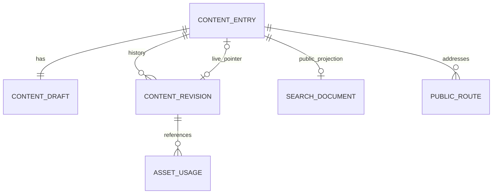

# Dữ liệu, API và chuyển nội dung

Tài liệu này là thiết kế cho toàn bộ roadmap. Hợp đồng và schema **đã triển khai** của quản lý tài khoản, mật khẩu và CMS trang chủ/menu được ghi tại [Identity & Site](identity-site.md). Bản hiện tại dùng ba role cố định; Site dùng chung managed_document/document_release cho HOME và MENU. Public API tương ứng là /public/site/home và /public/site/menu.

> Bảng/API bên dưới mô tả thiết kế tổng thể. Hợp đồng Academics đã triển khai dùng tiền tố `/api/v1/{admin|public}/academics`; chi tiết ở [Academics](academics.md). Khung/chứng nhận hiện nằm trong JSONB edition, quan hệ chương trình–đợt tuyển là bảng có khóa ngoại.

## Bổ sung toàn văn đã triển khai

- Draft và public article có `origin` tùy chọn: `{ url, publishedOn, author, retrievedOn }`. Ngày dùng ISO `YYYY-MM-DD`; `publishedOn` có thể null, `retrievedOn` bắt buộc nếu có origin. URL phải HTTPS, tác giả tối đa 200 ký tự, ngày đăng không sau ngày đối chiếu. `publishedAt` tiếp tục là thời điểm xuất bản thực tế.
- `document` hỗ trợ `table`, `tableRow`, `tableCell`, `tableHeader`, `inlineImage`; `rowspan`/`colspan` là số nguyên dương. Ảnh tham chiếu UUID `assetId` với alt/caption/href theo vị trí, không lưu URL ảnh từ xa trong tài liệu CMS. Có H2–H6, căn lề, subscript/superscript. Lưu/preview/publish/restore dùng cùng schema.
- `GET /api/v1/admin/media?page=0&size=60&q=faculty`: trả mảng ảnh theo trang, tìm theo tên tệp. `page` từ 0 đến 100000, `size` 1–60, `q` tối đa 200 ký tự; mặc định lần lượt 0/60/rỗng. Quyền sở hữu được lọc ở backend. Trang trả ít hơn size là trang cuối; frontend giữ các trang đã tải.
- Flyway V6 thêm `discovery.search_document.source_published_on` nullable. Nguồn nằm trong snapshot Publishing, projection được cập nhật qua port khi xuất bản; thứ tự tin dùng ngày nguồn nếu có, ngược lại ngày publish.
- Tài nguyên Academics nhận HTTPS hoặc URL bài nội bộ đúng mẫu `/vi|en/tin-tuc/<slug>` để truy cập toàn văn nguồn.

Gói nguồn, đối chiếu ảnh/văn bản, seed idempotent và giới hạn chuyển dữ liệu: [Nhập toàn văn](reference-import.md).

## Quy ước PostgreSQL

Một database, schema theo module: `identity`, `publishing`, `academics`, `directory`, `research`, `media`, `site`, `discovery`, `platform`. Flyway quản lý thứ tự migration toàn ứng dụng. Mỗi module chỉ ghi bảng của mình; các thay đổi liên module gọi API module trong cùng transaction.

| Quy tắc           | Thiết kế                                                                     |
| ----------------- | ---------------------------------------------------------------------------- |
| Định danh         | UUID; ID không mang thông tin quyền hoặc URL                                 |
| Thời gian         | `timestamptz`, lưu UTC, UI dùng `Asia/Ho_Chi_Minh`                           |
| Concurrent update | `version bigint`, optimistic locking tại SQL/JPA                             |
| Locale            | `vi`, `en`; một bản ghi nội dung theo locale, cùng translation group         |
| Bản công khai     | Con trỏ tới snapshot immutable; public query không đọc working draft         |
| JSONB             | Chỉ cho document/block có schema/version và metadata phù hợp                 |
| Dữ liệu quan hệ   | Quyền, thời hạn, bậc học, taxonomy và quan hệ dùng cột/bảng rõ ràng          |
| Xóa               | Archive/withdraw trước; purge có retention và kiểm tra reference             |
| Constraint        | FK, unique, check và index bên cạnh validation nghiệp vụ                     |
| Audit             | Actor, action, resource ID, timestamp, request ID; không log password/cookie |

FK xuyên schema có thể dùng cho identity/reference ổn định vì ứng dụng triển khai cùng nhau, nhưng không tạo quan hệ JPA điều hướng xuyên module. Không cascade delete giữa các domain. Với resource reference đa loại, registry kiểm tra loại/ID qua hợp đồng và lưu reference có kiểu; không dùng reference tự do cho dữ liệu lõi như campaign–program.

## Bảng chính dự kiến

| Schema     | Bảng                                                                                                                                                                                            |
| ---------- | ----------------------------------------------------------------------------------------------------------------------------------------------------------------------------------------------- |
| identity   | `account`, `role`, `permission`, `account_role`, `role_permission`, bảng Spring Session và reset token                                                                                          |
| publishing | `content_entry`, `content_draft`, `content_revision`, `category`, `tag`, `entry_category`, `entry_tag`                                                                                          |
| academics  | `academic_program`, `program_draft`, `program_edition`, `curriculum_version`, `accreditation`, `admission_campaign`, `campaign_draft`, `campaign_edition`, `campaign_program`                   |
| directory  | `staff_profile`, `staff_draft`, `staff_edition`, `organization_unit`, `staff_assignment`, `laboratory`, `laboratory_draft`, `laboratory_edition`, `equipment_item`                              |
| research   | `research_project`, `project_draft`, `project_edition`, `project_member`, `scholarly_work`, `work_draft`, `work_edition`, `work_author`, `conference`, `conference_draft`, `conference_edition` |
| media      | `asset`, `asset_variant`, `asset_usage`, `upload_session`                                                                                                                                       |
| site       | `navigation_menu`, `menu_draft`, `menu_release`, `home_composition`, `home_release`, `public_route`, `redirect`, `site_setting`                                                                 |
| discovery  | `search_document`                                                                                                                                                                               |
| platform   | `audit_event`, `idempotency_record`, `migration_batch`, `migration_item`; `outbox_event` khi có external side effect                                                                            |

Đây là model logic để thiết kế migration chi tiết ở từng lát cắt. Không khởi tạo hàng loạt bảng chưa dùng. Các bảng `*_edition` giữ payload có cấu trúc theo schema riêng của domain; trường cần query/filter có cột rõ ràng. Join table phục vụ public phải gắn edition ID hoặc được đổi đồng bộ khi publish, không dùng dữ liệu nháp để dựng public response.

### Cấu trúc xuất bản



`content_entry`: id, type, locale, translation_group_id, owner_id, lifecycle, live_revision_id nullable, version, created_at, updated_at.

`content_draft`: entry_id, draft_version, title, slug, summary, document_json, document_schema_version, seo_json, template_key, updated_by, updated_at.

`content_revision`: id, entry_id, revision_number, source_draft_version, locale, title, slug, summary, document_json, schema_version, seo_json, published_by, published_at. Không sửa revision đã được commit.

Unique `(entry_id, revision_number)`; index trên `(entry_id, source_draft_version)`. Publish lại bản đang live mà chưa sửa trả lại kết quả hiện hành, không tạo revision mới. Sau withdraw, người dùng có thể đăng lại cùng nội dung bằng một lần xuất bản mới. FK live revision phải bảo đảm revision thuộc cùng entry; dùng composite constraint hoặc cơ chế tương đương, không chỉ FK trên revision ID. Mỗi lần autosave phải tăng cả draft version và aggregate version trong cùng transaction.

Danh mục/tài nguyên ảnh hưởng hiển thị phải được snapshot hoặc tham chiếu theo version. Không để sửa nháp category assignment làm thay public article. Khôi phục lịch sử tạo draft mới; slug, quyền và ownership không tự hoàn nguyên một cách không kiểm soát.

## REST API

API có prefix `/api/v1`; phân chia rõ public, admin và auth. DTO public có allowlist field và chỉ chứa bản đang công khai. DTO admin có version, draft/live status và capability. Không trả entity JPA.

| Method và route                                                       | Mục đích                                                                   |
| --------------------------------------------------------------------- | -------------------------------------------------------------------------- |
| `GET /auth/csrf`                                                      | Khởi tạo/lấy token chống CSRF                                              |
| `POST /auth/login`                                                    | Tạo phiên và route hint                                                    |
| `POST /auth/logout`                                                   | Hủy phiên và cookie                                                        |
| `POST /auth/change-password`                                          | Đổi mật khẩu với phiên và mật khẩu hiện tại                                |
| `POST /auth/reset-password`                                           | Đặt mật khẩu bằng token dùng một lần, thu hồi phiên cũ                     |
| `GET /auth/me`                                                        | Tài khoản, quyền và trạng thái phiên hiện hành                             |
| `GET /auth/route-context`                                             | Đồng bộ route hint có ký, chỉ với phiên hợp lệ                             |
| `GET /public/home?locale=vi`                                          | Dữ liệu trang chủ gồm composition và section đã resolve                    |
| `GET /public/content?locale=vi&type=ARTICLE`                          | Danh sách nội dung công khai                                               |
| `GET /public/content/{id}`                                            | Chi tiết entry đang public; locale thuộc entry được trả rõ trong DTO       |
| `GET /public/programs`                                                | Chương trình công khai                                                     |
| `GET /public/admissions?status=open`                                  | Chiến dịch theo trạng thái thực                                            |
| `GET /public/people`, `/public/labs`                                  | Nhân sự và phòng thí nghiệm                                                |
| `GET /public/research/projects`, `/public/research/works`             | Dữ liệu nghiên cứu                                                         |
| `GET /public/conferences`, `/public/documents`                        | Hội thảo và thư viện tài liệu                                              |
| `GET /public/search?q=dat+dai&locale=vi`                              | Tìm kiếm public                                                            |
| `GET /public/routes/resolve?locale=vi&path=...`                       | Resolve path trong locale thành resource type/ID hoặc redirect đã validate |
| `GET /public/sitemap?locale=vi`                                       | Danh sách URL đang công khai, phân trang nếu cần                           |
| `POST /admin/content`                                                 | Tạo entry nháp                                                             |
| `GET /admin/content/{id}`                                             | Working draft và metadata live                                             |
| `PATCH /admin/content/{id}/draft`                                     | Sửa nháp/autosave, bắt buộc version                                        |
| `POST /admin/content/{id}/publish`                                    | Đăng draft hiện hành, không qua duyệt                                      |
| `POST /admin/content/{id}/withdraw`                                   | Gỡ bài                                                                     |
| `POST /admin/content/{id}/archive`                                    | Lưu trữ sau khi đã gỡ                                                      |
| `GET /admin/content/{id}/revisions`                                   | Lịch sử phân trang                                                         |
| `POST /admin/content/{id}/restore-revision`                           | Khôi phục revision vào draft mới                                           |
| `GET /admin/content/{id}/preview`                                     | DTO preview yêu cầu quyền, không cache                                     |
| `POST /admin/media/uploads`                                           | Tạo upload session, giới hạn type/size                                     |
| `POST /admin/media/uploads/{id}/complete`                             | Xác nhận object, bắt đầu kiểm tra/xử lý                                    |
| `POST /admin/programs/{id}/publish`, `/admin/admissions/{id}/publish` | Công khai dữ liệu domain có cấu trúc                                       |
| `GET/POST/PATCH /admin/users...`                                      | Quản lý tài khoản qua command phù hợp                                      |
| `POST /admin/users/{id}/reset-links`                                  | Tạo reset link dùng một lần, chỉ trả secret tại lần tạo                    |
| `GET /admin/audit`                                                    | Nhật ký theo phạm vi quyền                                                 |

Các resource nhân sự, phòng thí nghiệm và nghiên cứu có collection/detail/draft/publish/withdraw tương ứng. API domain-specific như `extend-deadline`, `complete-project`, `cancel-conference` diễn đạt ý nghĩa thao tác; không mở `PATCH status` tùy ý.

Public frontend resolve từ `(locale, path)` sang `resourceType`, `resourceId` và `canonicalPath`, rồi gọi detail query bằng ID. Như vậy article và page có thể cùng slug ở hai namespace mà không nhập nhằng. Các resource khác dùng cùng quy ước detail bằng ID; DTO đầy đủ được khóa trong OpenAPI theo từng lát cắt.

## Quy ước contract

- Pagination có `page`, `size` tối đa 50 và sort allowlist; tie-break bằng ID để kết quả ổn định.
- Ngày ISO 8601 kèm offset; enum và mã lỗi không phụ thuộc ngôn ngữ UI.
- Lỗi dùng Problem Details: `type`, `title`, `status`, `code`, `detail`, `instance`, `traceId`, `fieldErrors` khi có.
- 401: chưa đăng nhập/phiên hết hạn; 403: thiếu quyền; 404: không tồn tại hoặc không công khai; 409: xung đột slug/trạng thái; 412: version không còn đúng; 422: vi phạm dữ liệu/nghiệp vụ; 428: thiếu precondition bắt buộc.
- Ghi draft nhận `If-Match` từ ETag/version. DB compare-and-update/JPA version mới là kiểm tra cuối; kiểm tra Java trước đó không đủ.
- Publish gửi `draftVersion` để không đăng nhầm bản khác; hỗ trợ `Idempotency-Key` để retry sau lỗi mạng không tạo hai lần xuất bản.
- Bản ghi idempotency có actor, route, key, request hash, kết quả và hạn lưu. Cùng key khác payload trả lỗi. Retry vẫn kiểm tra phiên và quyền hiện hành.
- Contract được sinh và diff trong CI; thay đổi breaking phải có migration và kế hoạch tương thích.

Ví dụ command:

```http
POST /api/v1/admin/content/{id}/publish
If-Match: "entry-v12"
Idempotency-Key: <uuid>
X-CSRF-TOKEN: <token>

{"draftVersion":7}
```

Kết quả trả `entryId`, `revisionId`, `publishedAt`, `publicUrl`, `version`. UI chỉ báo “Đã đăng công khai” khi nhận thành công sau commit.

## Autosave và thao tác đồng thời

Autosave debounce khoảng 1–2 giây khi editor ngừng nhập; mỗi request có version, UI có trạng thái Đang lưu/Đã lưu/Lỗi lưu. Trước publish phải flush autosave và dùng version được backend xác nhận. Khi có conflict, giữ nội dung người dùng đang nhập, tải phiên bản mới để so sánh; không tự ghi đè.

Hai người publish cùng draft: idempotency/version bảo đảm một kết quả hợp lệ. Upload và preview không giữ transaction DB trong thời gian dài. Tác vụ object storage không nằm trong DB transaction; publication chỉ dùng asset đã READY.

## Media và nội dung editor

S3 bucket mặc định private. Upload có thời hạn và giới hạn kích thước/MIME ở server; complete phải xác minh object thật. Kiểm tra magic bytes, kích thước, decode ảnh, tên tệp an toàn; không tin Content-Type do trình duyệt khai báo. SVG/script/raw HTML bị từ chối trong luồng tải ảnh phổ thông. Tệp văn phòng phục vụ download, không thực thi inline.

Backend tạo variant ảnh theo preset; key versioned/immutable. Public media endpoint xác minh asset có public usage, private download xác minh quyền. Quy tắc cache theo visibility: tài liệu riêng tư `no-store`; ảnh công khai có TTL hữu hạn theo chính sách. Gỡ bài ngăn truy cập nội dung ở lần GET mới; bản ảnh đã được tải/cache trên thiết bị không thể thu hồi từ thiết bị đó.

JSON document có `schemaVersion`, node/mark allowlist, giới hạn độ sâu/dung lượng, URL protocol allowlist và reference đã kiểm tra. Render bằng mapper React định kiểu; không đưa raw HTML từ CMS vào `dangerouslySetInnerHTML`. Nếu import HTML cũ, sanitize và chuyển sang node được hỗ trợ; phần không chuyển được đưa vào báo cáo để xử lý. [Tiptap JSON output](https://tiptap.dev/docs/guides/output-json-html).

Thumbnail của draft và preview dùng kênh có xác thực, không đưa qua bộ tối ưu ảnh dùng chung làm mất ngữ cảnh quyền. Các asset public được phục vụ bằng ID/version và MIME chính xác. Endpoint upload/download/complete đều kiểm tra ownership hoặc quyền media tương ứng.

Sửa schema cần migration document và renderer hỗ trợ phiên bản chuyển tiếp. Rich text document và layout block là hai schema khác nhau: một cho nội dung bài, một cho bố cục trang.

## Tìm kiếm tiếng Việt

V1 dùng PostgreSQL: cột văn bản tìm kiếm đã chuẩn hóa dấu/chữ thường, `tsvector` với cấu hình phù hợp, GIN và `pg_trgm` cho tên/tiêu đề. Giữ nguyên nội dung gốc để hiển thị. Không coi `simple` là bộ phân tích ngôn ngữ tiếng Việt đầy đủ.

Chuẩn hóa ở lúc cập nhật projection và truy vấn, kiểm thử `đ/Đ`, dấu tổ hợp Unicode, tên có dấu/không dấu và mã ngành. Không tạo generated column gọi hàm không immutable tùy tiện; dùng giá trị chuẩn hóa được application/trigger kiểm soát. [PostgreSQL unaccent](https://www.postgresql.org/docs/current/unaccent.html), [pg_trgm](https://www.postgresql.org/docs/current/pgtrgm.html).

Mỗi SearchDocument có `(source_type, source_id, locale)` duy nhất, title, summary, search text, canonical path, published_at và facets. Publish/withdraw cập nhật cùng transaction. Rebuild dùng phiên bản nguồn hoặc write fence để dữ liệu cũ không ghi đè lần publish/withdraw mới; tuyệt đối không dựng chỉ mục trực tiếp từ bảng draft.

## Chuyển dữ liệu website cũ

1. Inventory URL, loại nội dung, ngày đăng, ảnh, tệp, external link và trạng thái HTTP. Xuất manifest có source URL, checksum và chủ đề.
2. Ưu tiên export từ CMS cũ nếu có quyền quản trị. Nếu chỉ có public site, fetch giới hạn tốc độ và chỉ các host đã xác định; không lấy phần có đăng nhập.
3. Lưu snapshot nguồn và ánh xạ schema. Giữ ngày đăng gốc riêng với thời điểm import; không biến mọi tin cũ thành “tin mới”.
4. Chuyển HTML sang document JSON; thu ảnh/tệp về storage, thay đường dẫn bằng asset ID, phát hiện link hỏng và ảnh thiếu.
5. Map các ngành, nhân sự và dự án vào domain có cấu trúc. Không tự đoán mã ngành, tín chỉ, hạn tuyển hay thời hạn chứng nhận khi nguồn thiếu.
6. Nhập staging dưới dạng draft; tác vụ import không tự công khai. Người phụ trách đối chiếu bản xem trước rồi có thể publish bằng công cụ bulk có quyền và audit. Đây là kiểm tra chất lượng chuyển dữ liệu, không phải workflow duyệt bài thường ngày.
7. Lập redirect 301 từng URL cũ sang canonical URL mới, kể cả đuôi `.html` và slug lỗi dấu. Không redirect tất cả về trang chủ. External conference site có thể giữ link gốc.
8. Chạy dry run, đối chiếu tổng số bài/tệp theo chuyên mục, kiểm tra URL quan trọng, lập danh sách không thể chuyển và cách xử lý từng mục.
9. Trước cutover, chốt thời điểm dừng cập nhật ở CMS cũ hoặc chạy delta import; đồng bộ URL map rồi kiểm tra lại.

Importer là CLI/profile thuộc cùng Spring Boot codebase, gọi use case hoặc migration façade có cùng invariant. Dùng source ID/URL và checksum cho idempotency; không sửa trực tiếp DB để bỏ qua domain. Không cho một lần import lại ghi đè nội dung đã được biên tập ở CMS mới mà không có conflict report.
