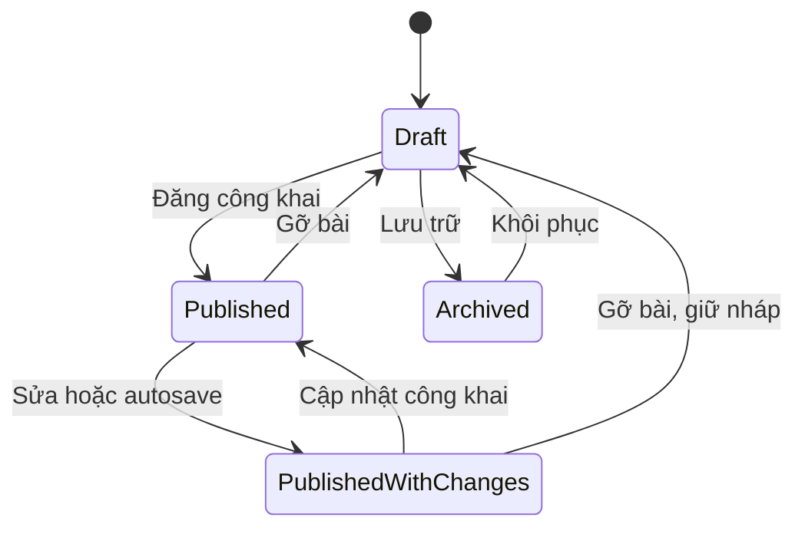
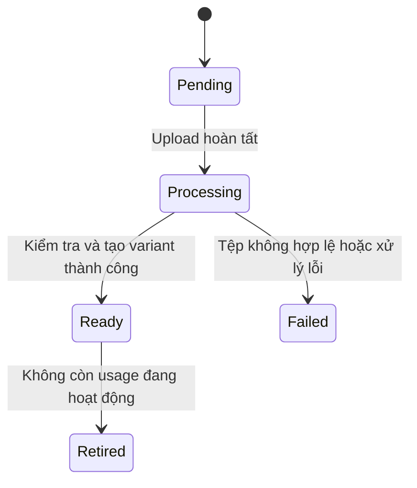

# Mô hình domain và quy tắc nghiệp vụ

## Ranh giới nghiệp vụ

| Module       | Vai trò           | Aggregate chính                                | Dữ liệu sở hữu                                                             |
| ------------ | ----------------- | ---------------------------------------------- | -------------------------------------------------------------------------- |
| `publishing` | Core domain       | ContentEntry, Category                         | Bài viết, trang nội dung, phiên bản, taxonomy, trạng thái công khai        |
| `academics`  | Core domain       | AcademicProgram, AdmissionCampaign             | Ngành, bậc học, phiên bản chương trình, chứng nhận, đợt tuyển              |
| `directory`  | Supporting domain | StaffProfile, OrganizationUnit, Laboratory     | Hồ sơ cán bộ, cơ cấu, phòng thí nghiệm, thiết bị                           |
| `research`   | Supporting domain | ResearchProject, ScholarlyWork, Conference     | Đề tài, công bố, thành viên, đối tác, hội thảo                             |
| `media`      | Supporting domain | MediaAsset                                     | Tệp gốc, variant, trạng thái xử lý, usage, quyền truy cập                  |
| `site`       | Supporting domain | NavigationMenu, HomeComposition, RouteRegistry | Điều hướng, cấu hình trình bày, URL công khai và redirect                  |
| `identity`   | Supporting domain | Account, Role                                  | Tài khoản, quyền, trạng thái truy cập và phiên                             |
| `discovery`  | Read module       | SearchDocument projection                      | Chỉ mục tìm kiếm của nội dung đang công khai                               |
| `platform`   | Hạ tầng chung     | Không đặt aggregate nghiệp vụ ở đây            | Transaction wiring, logging, audit sink, health, cơ chế job/outbox khi cần |

Thông báo, học bổng, việc làm, hoạt động sinh viên, cựu sinh viên và chuyển giao có thể là content type/category của Publishing. Không tách chúng thành service hoặc bounded context khi chưa có vòng đời riêng. Giáo trình và bài báo có dữ liệu thư mục dùng ScholarlyWork. Tài liệu tải về dùng ContentEntry kiểu RESOURCE tham chiếu MediaAsset.

## Publishing

`ContentEntry` là aggregate root cho ARTICLE, PAGE, ANNOUNCEMENT và RESOURCE. Mỗi locale có entry riêng, liên kết bằng `translationGroupId`. Các loại dùng chung cơ chế nháp/xuất bản nhưng có publication policy khác nhau: RESOURCE cần tệp hoặc liên kết hợp lệ; PAGE cần template; ARTICLE cần nội dung và chuyên mục.

Thành phần model:

- Value object: `ContentId`, `Locale`, `Slug`, `Title`, `SeoMetadata`, `RichDocument`, `ContentReference`, `PublicationInfo`.
- Working draft có `draftVersion`; revision được xuất bản là immutable snapshot.
- Root giữ metadata, bản nháp hiện hành và con trỏ revision đang công khai. Lịch sử revision đọc phân trang, không nạp thành danh sách không giới hạn trong aggregate.
- Ảnh/tệp là reference bằng ID, alt/caption theo vị trí sử dụng; không nhúng base64 hoặc đường dẫn filesystem vào body.

| Hành vi                                                | Bất biến                                                                                                    |
| ------------------------------------------------------ | ----------------------------------------------------------------------------------------------------------- |
| `createDraft(...)`                                     | Có owner hợp lệ; loại nội dung và locale được hỗ trợ                                                        |
| `reviseDraft(expectedVersion, changes)`                | Đúng version; không sửa snapshot đã xuất bản; cấu trúc document hợp lệ                                      |
| `changeSlug(...)`                                      | Slug hợp lệ, không thuộc route dành riêng; uniqueness được bảo đảm tại registry trong transaction           |
| `publish(expectedDraftVersion, readiness, actor, now)` | Entry chưa lưu trữ; đúng draft; đủ trường theo loại; tài nguyên READY; liên kết bắt buộc hợp lệ             |
| `withdraw(actor, reason, now)`                         | Đang công khai; lưu lý do, gỡ pointer/visibility và phát event                                              |
| `restoreRevision(revision, actor)`                     | Revision thuộc entry và locale này; tạo bản nháp mới, không thay live ngay                                  |
| `archive(actor, now)`                                  | Không còn public; nếu thao tác UI là “Gỡ và lưu trữ” thì application điều phối cả hai trong một transaction |
| `restoreFromArchive(actor)`                            | Trở lại bản nháp; không tự đăng lại                                                                         |

Public API không nhận trường `status` cho client tự đổi. Domain chỉ cho chuyển trạng thái qua hành vi.

### Phần mở rộng toàn văn đã triển khai

`ContentDraft` chứa `ContentOrigin` tùy chọn: URL HTTPS, ngày đăng gốc, tác giả và ngày đối chiếu. Value object tự kiểm tra ngày đăng không sau ngày đối chiếu; nằm trong snapshot nên sửa nháp/khôi phục không làm đổi nguồn của bản public hiện hành. Thời điểm thao tác publish và actor kiểm toán vẫn độc lập với tác giả/ngày của nguồn.

`RichDocument` kiểm tra bảng/ô gộp, H2–H6, căn lề, chỉ số trên/dưới và ảnh trong dòng. Ảnh ở mọi độ sâu đều được thu thập để kiểm tra quyền, trạng thái và đăng ký usage qua Media port. Bài có ảnh vẫn có thể công khai khi nguồn không có đoạn văn; bài không ảnh phải có tối thiểu 20 ký tự nội dung. Renderer chỉ dùng node allowlist.

Discovery nhận ngày đăng gốc qua hợp đồng Publishing và ưu tiên ngày này khi sắp xếp tin. Không đọc nháp hoặc dùng ngày nguồn để thay audit. Nội dung nghiên cứu/hồ sơ nguồn hiện được bảo toàn trong Publishing; domain Directory/Research có cấu trúc ở trên vẫn là roadmap.



Đây là các trạng thái UI được suy ra từ lifecycle, live pointer và draft version. Không tạo thêm một cột trạng thái thứ hai có thể lệch với live pointer.

### Ví dụ domain có hành vi

Pseudocode dưới đây thể hiện vị trí của quy tắc; chưa phải code triển khai:

```java
public PublicationSnapshot publish(
    DraftVersion expected,
    PublicationReadiness readiness,
    PublishingActor actor,
    Instant now
) {
    ensureNotArchived();
    ensureDraftVersion(expected);
    if (isLive() && publishedDraftVersion.equals(draft.version())) {
        return currentPublication();
    }
    publicationPolicy.validate(draft, readiness);
    PublicationSnapshot snapshot = draft.freezeForPublication(actor.id(), now);
    liveRevisionId = snapshot.id();
    publishedDraftVersion = draft.version();
    record(new ContentPublished(id, snapshot.id(), locale, now));
    return snapshot;
}
```

Application handler kiểm tra `content:publish:own|any`, tải aggregate, lấy readiness qua port, gọi phương thức trên, lưu revision và cập nhật projection. Domain tự kiểm tra nội dung có thể xuất bản; application không gán `entity.setStatus(PUBLISHED)`.

`PublicationReadiness` chứa bằng chứng tài nguyên/tham chiếu được kiểm tra trong cùng transaction. Để không có khoảng trống giữa kiểm tra và sử dụng, media/reference adapter khóa bản ghi hoặc dùng version/precondition tương ứng; một object boolean được tạo từ truy vấn cũ không đủ.

`Category` có `rename`, `reparent`, `retire`; không tự làm cha/con của chính nó, không tạo vòng lặp cây. Giới hạn độ sâu hai hoặc ba cấp theo UI. Category đang được dùng có thể ngừng cho gán mới, không làm mất bài cũ.

## Academics

Mốc triển khai hiện tại và các quyết định lưu trữ: [Academics](academics.md). Khung/chứng nhận là entity trong snapshot JSONB; contact hiện là value object, chưa phụ thuộc Directory.

### AcademicProgram

Là ngành/chương trình có định danh ổn định: mã ngành, tên, bậc học, văn bằng, đơn vị, thời lượng, chuẩn đầu ra, cơ hội nghề nghiệp và đầu mối liên hệ. Phần mô tả thuộc ProgramEdition; bài tin tuyển sinh liên quan không phải nguồn dữ liệu chuẩn của chương trình.

`ProgramEdition` là snapshot có phiên bản: thông tin công khai và tham chiếu CurriculumVersion/Accreditation. `CurriculumVersion` là entity/version thuộc chương trình, được truy vấn riêng khi lịch sử dài. Chuẩn bị draft và live edition riêng để sửa tên, thời lượng hay tài liệu không tự lọt ra public.

Hành vi: `reviseEdition`, `attachCurriculum`, `recordAccreditation`, `publishEdition`, `retire`, `reinstate`.

Bất biến:

- Mã chương trình phải duy nhất; bậc học và loại văn bằng dùng danh mục có kiểm soát.
- Thời lượng/tín chỉ nếu khai báo phải dương; không tự suy diễn số liệu khi website cũ thiếu.
- Curriculum thuộc đúng chương trình; khoảng hiệu lực hợp lệ; không có hai bản được chọn là hiện hành cho cùng cohort/phạm vi.
- Chứng nhận ghi tổ chức, ngày cấp, thời hạn nếu có và tài liệu chứng minh; không hiển thị “đang còn hiệu lực” chỉ dựa vào bài tin cũ.
- Publish edition cần tên, mô tả, bậc học và đầu mối; giấy chứng nhận không bắt buộc nếu chương trình chưa có.
- Ngừng công khai chương trình phải xử lý các chiến dịch tuyển đang gắn với nó; application dùng policy cùng module; adapter hiện dùng advisory transaction lock cho các mutation Academics để tránh race.

### AdmissionCampaign

Aggregate riêng gồm mã đợt, năm, bậc học, danh sách chương trình, hạn nộp, lịch dự kiến, link hệ thống tuyển sinh và người liên hệ.

Hành vi: `revise`, `publish`, `extendDeadline`, `closeEarly`, `withdraw`, `statusAt(now)`.

Bất biến:

- `opensAt < closesAt`; gia hạn phải có hạn mới hợp lệ và lý do.
- Chiến dịch public chỉ gắn chương trình đang công khai, có năm tuyển và đầu mối liên hệ.
- Mốc đóng nhận hồ sơ khác với thời điểm gỡ thông báo. Hết hạn vẫn có thể đọc thông báo nhưng hiện rõ “Đã kết thúc nhận hồ sơ”.
- Trạng thái còn hạn được tính từ đồng hồ server và override đóng sớm; không phụ thuộc một cron có chạy thành công hay không.
- Lưu timestamp theo UTC, nhập/hiển thị giờ Việt Nam. “Hết ngày 28/8” được chuẩn hóa thành cận trên loại trừ đầu ngày 29/8 theo múi giờ đã chọn, tránh sai ở giây cuối ngày.
- Trang chủ chọn đợt hiện hành bằng điều kiện nghiệp vụ, không chỉ lấy bài đăng gần nhất.

## Directory

`StaffProfile` có thông tin công khai tách biệt với `Account`. Một cán bộ có thể có profile mà không có tài khoản CMS; tài khoản quản trị không mặc nhiên là giảng viên.

Phần đã triển khai: `StaffProfile` là aggregate riêng với bản nháp, bản công khai, version lạc quan và hành vi `revise`, `publish`, `withdraw`. `StaffDetails` lưu thuộc tính cơ bản và các `StaffSection` có khối `FACT` (nhãn–giá trị), `TEXT`, `LIST`, `TABLE`, `IMAGE`; mọi hồ sơ render từ cùng component theo một trong năm template. Trường tùy chọn trống không hiển thị; `privateNotes` bị loại khỏi public DTO. 17 bài lý lịch tham khảo được chuyển sang hồ sơ bằng script có checkpoint và redirect URL cũ. Hồ sơ mới được tạo trực tiếp trong CMS, không cần bài viết trung gian.

Hành vi: `reviseProfile`, `assignToUnit`, `setPublicContact`, `publishProfile`, `markInactive`, `withdrawProfile`. Không công khai thông tin đăng nhập hoặc dữ liệu riêng tư. Nhân sự nghỉ/chuyển công tác có thể giữ hồ sơ lịch sử với nhãn phù hợp.

`OrganizationUnit` giữ cấu trúc đơn vị và tên dịch; không cho cây tổ chức có vòng lặp. Chuyển nhân sự phải để lại mốc thời gian nếu hiển thị lịch sử công tác.

`Laboratory` có chức năng, địa điểm, người phụ trách, ảnh và `EquipmentItem`. Hành vi `revise`, `assignContact`, `addEquipment`, `retireEquipment`, `publishProfile`. Thiết bị ngừng hoạt động không còn nằm trong danh sách đang sử dụng. Chưa mở rộng thành hệ thống đặt lịch hoặc quản lý tài sản.

Phần đã triển khai là `LaboratoryProfile` với draft/live, version lạc quan, publish/withdraw và `LabContent` có các trường cố định: giới thiệu, chức năng, nhiệm vụ, lĩnh vực nghiên cứu, thiết bị, học phần và công bố. Thiết bị có ảnh riêng; các danh sách là value object có kiểu. API chuyển các `sections` cũ sang `content` khi đọc, còn CMS và public sử dụng `content`. Hai hồ sơ tham khảo vẫn giữ `sections` lịch sử để đối chiếu. Danh mục thiết bị độc lập, vòng đời bảo trì/ngừng sử dụng và người phụ trách liên kết trực tiếp với StaffProfile là bước mở rộng sau, chưa phải hệ thống quản lý tài sản.

Supporting domain chỉ bổ sung hành vi khi có luật thực. Một danh mục tên/nhãn đơn giản được giữ đơn giản; không tạo state machine hình thức cho mọi bảng để gọi là DDD.

## Research

`ResearchProject`: đề tài, mã, cấp đề tài, thời gian, chủ nhiệm, thành viên, đối tác, nguồn tài trợ, trạng thái và kết quả.

Hành vi: `reviseDetails`, `assignPrincipalInvestigator`, `start`, `extendPeriod`, `complete`, `publishProfile`, `withdrawProfile`. Ngày kết thúc không trước ngày bắt đầu; hoàn thành phải có ngày hoàn thành; cùng một thành viên không xuất hiện trùng vai trò. Trạng thái tiến độ dự án độc lập với trạng thái công khai hồ sơ.

`ScholarlyWork`: bài báo, giáo trình, báo cáo hội thảo; giữ tên, tác giả, năm, venue, DOI/ISBN nếu có, liên kết và tài liệu được phép chia sẻ. Hành vi `reviseCitation`, `attachPublicCopy`, `publishRecord`, `withdrawRecord`. DOI được chuẩn hóa và kiểm tra trùng; không bắt buộc DOI cho loại tài liệu không có DOI. File được phép chia sẻ khác với việc trích dẫn một công bố.

`Conference`: hội thảo của đơn vị, thời gian, địa điểm, chương trình, website ngoài, ảnh và tài liệu. Hành vi `reschedule`, `cancel`, `publish`, `archive`. Khoảng thời gian hợp lệ; hủy hội thảo giữ lý do và thông báo. Hội thảo cũ được đưa vào trang lưu trữ theo năm, không tạo một mục menu cấp một cho mỗi năm.

## Media

`MediaAsset` chứa metadata object storage, checksum, MIME, kích thước, chiều ảnh, trạng thái và visibility. Các byte của một asset đã READY không bị ghi đè; thay tệp tạo version/asset mới để tránh cache sai và giữ lịch sử.



Hành vi `acceptUpload`, `completeProcessing`, `failProcessing`, `registerUsage`, `releaseUsage`, `retire`. Không publish nội dung chứa asset chưa READY. Không xóa asset đang được bản public dùng. Draft/revision reference được giữ theo retention policy để khôi phục không bị mất ảnh.

Public usage và private usage được phân biệt. Asset mặc định private khi upload. Tài liệu hạn chế truy cập không được chuyển thành public chỉ vì editor thêm nhầm vào bài; publication policy phải chặn và yêu cầu thao tác thay visibility có quyền riêng.

## Site và Discovery

`NavigationMenu` dùng `InternalResourceLink` hoặc external HTTPS URL. Internal link lưu resource ID/locale, resolve bằng RouteRegistry. Menu tối đa hai cấp ở public; thứ tự ổn định; retire nội dung không để menu dẫn vào draft.

`HomeComposition` gồm các section/block thuộc allowlist. Hành vi `replaceHero`, `reorderSections`, `pinContent`, `publishComposition`. Một hero, không trùng section key, featured reference phải công khai và đúng locale. Nội dung bị gỡ được resolver loại khỏi danh sách nổi bật ngay.

`RouteRegistry` giữ `(locale, path)` duy nhất và lịch sử redirect. Hành vi `claim`, `move`, `withdraw`, `redirect`. Đổi slug của bài đã đăng phải đăng ký route mới và redirect cũ trong một transaction. Không cho redirect vòng lặp, redirect vào `/admin` hoặc external URL không được duyệt cấu hình. Unique constraint là hàng rào cuối cho thao tác đồng thời.

Discovery chỉ sở hữu public projection. Nó không quyết định quyền xuất bản, không giữ draft và không là nguồn chuẩn của bài viết. Có thể xóa rồi xây lại từ các public query API của từng domain.

## Identity

`Account` có `activate`, `disable`, `changeRoleAssignments`, `changePassword`, `revokeSessions`. Không vô hiệu hóa hoặc bỏ quyền của quản trị viên hoạt động cuối cùng; kiểm tra này cần khóa/serialize thay đổi tập quản trị để hai request đồng thời không cùng vượt qua.

Role và permission có phạm vi. Quyền thao tác dữ liệu nhạy cảm được kiểm tra ở application policy dựa trên actor đáng tin cậy. Ownership của bài không lấy từ form và không thay đổi tự do khi cập nhật nội dung.

## Hợp đồng giữa domain và design system

Domain biểu đạt nghĩa: loại nội dung, trạng thái tuyển sinh, bậc đào tạo, ngày xuất bản và reference. UI quyết định font, màu, khoảng cách và bố cục. DB không chứa class Tailwind hay tên component React.

CMS block là schema sản phẩm có version, ví dụ `hero`, `program-list`, `news-list`, `text-media`, `document-list`, `contact`. Backend kiểm tra dữ liệu và reference; frontend ánh xạ block sang component đã được thiết kế. Trạng thái và capability được cung cấp bằng mã ổn định, UI dịch thành tiếng Việt/Anh.

## Editorial: hội thảo, tin tức, tuyển dụng (đã triển khai)

`EditorialItem` là aggregate có `kind` (`EVENT`, `NEWS`, `JOB`), locale, bản nháp và bản công khai riêng, version để chống ghi đè đồng thời. `EditorialDetails` giữ tiêu đề, slug, mô tả, thumbnail, liên kết ngoài và `articleId`. Hội thảo có ngày, địa điểm, đơn vị tổ chức, chủ đề, hình thức, đối tượng, link đăng ký cùng danh sách `EventSpeaker` và `EventSession` có kiểu; tuyển dụng có đơn vị, vị trí, hạn nộp. Trường chưa rõ từ nguồn để trống. Mỗi hồ sơ liên kết một bài viết khi công khai và bài viết chỉ thuộc một hồ sơ, kể cả khi hồ sơ đang sửa bản nháp khác với bản live; nội dung dài và lịch sử biên tập vẫn do Publishing sở hữu. `publish` yêu cầu bài viết liên kết đã công khai cùng locale và ảnh dùng được. Public query chỉ trả hồ sơ khi bài viết đó vẫn công khai. `revise`, `publish`, `withdraw` chạy trên aggregate; adapter JDBC, HTTP và CMS nằm ngoài domain. Menu có liên kết hệ thống `EVENTS`, `JOBS`.
