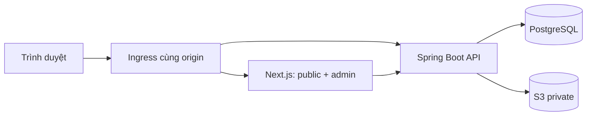

# Trạng thái triển khai — 16/10/2026

## Mốc hiện tại

Đã triển khai monorepo, xuất bản trực tiếp, tài khoản/phân quyền/mật khẩu, CMS trang chủ/menu, Academics, Directory, Editorial, Research, nhập Word/Excel và bản dịch Anh bằng AI. Đợt QA hiện tại được ghi tại [report 16/10/2026](qa-audit-2026-10-16.md).

| Hạng mục                                                             | Trạng thái                                                                                          |
| -------------------------------------------------------------------- | --------------------------------------------------------------------------------------------------- |
| Next.js 16.4.1 / TypeScript / App Router                             | Đã chạy; một FE có public và admin                                                                  |
| Spring Boot 4.1.1 / Java 21                                          | Đã chạy; một backend nghiệp vụ                                                                      |
| PostgreSQL 18.6 / Flyway                                             | Đã chạy; schema chia theo module                                                                    |
| Storage S3 / MinIO private                                           | Upload và đọc ảnh thật                                                                              |
| Domain có hành vi / ports & adapters                                 | ContentEntry, AcademicProgram, AdmissionCampaign và các value object/entity; kiểm tra bằng ArchUnit |
| Directory / hồ sơ cán bộ                                              | StaffProfile aggregate, draft/live, 5 template, CMS và public; 17 hồ sơ tham khảo được chuyển từ bài viết |
| Directory / phòng thí nghiệm                                          | LaboratoryProfile aggregate; trường cố định cho giới thiệu, chức năng, thiết bị, học phần, nghiên cứu và công bố; CMS 6 bước, public thống nhất, 2 hồ sơ nguồn được đọc chuyển đổi |
| Research / đề tài, công bố, sách, tài liệu                             | ResearchRecord aggregate, bản nháp/public, tác giả liên kết cán bộ, CMS/public; 501 bản ghi nguồn đã nhập |
| Nhập nhanh Excel                                                     | Mẫu nhiều sheet và import theo lô cho cán bộ, phòng thí nghiệm, hội thảo, nghiên cứu và chương trình; transaction và quyền CMS |
| Tác giả bài viết và chia sẻ mạng xã hội                                 | Byline riêng từng bản nháp/public; Facebook, LinkedIn, email, sao chép; canonical, OG/Twitter, JSON-LD và ảnh dự phòng |
| Đăng nhập, session, CSRF, scope quyền                                | Đã triển khai                                                                                       |
| Tài khoản, 3 vai trò, khóa/mở, thu hồi phiên                         | Đã triển khai; bảo vệ admin cuối khi cập nhật đồng thời                                             |
| Đổi/reset mật khẩu, liên kết mời dùng một lần                        | Đã triển khai; token hash, hạn 30 phút, thu hồi phiên                                               |
| Rich text, autosave, cover, inline image, preview                    | Đã triển khai                                                                                       |
| Publish trực tiếp, sửa nháp, cập nhật/gỡ bài                         | Đã triển khai                                                                                       |
| Version conflict, history, restore, idempotency                      | Đã triển khai                                                                                       |
| Trang chủ mới, list/search/detail, sitemap                           | Đã triển khai                                                                                       |
| CMS trang chủ, hero/ảnh, thứ tự khối, tin ghim, liên hệ              | Nháp → xem trước → công khai; history/restore                                                       |
| Menu hai cấp, thứ tự và liên kết tài nguyên                          | Resolve theo bản public; ẩn liên kết bài đã gỡ                                                      |
| Chương trình, bậc học, đầu ra/nghề nghiệp, khung/học phần, kiểm định | CMS 5 bước khi tạo, danh sách đầu ra/nghề nghiệp thêm từng dòng; public, nháp, edition, khôi phục, ngừng công khai |
| Tuyển sinh, chương trình/chỉ tiêu, hồ sơ, lịch trình                 | CMS/public; trạng thái theo giờ Việt Nam, gia hạn/đóng sớm có lý do                                 |
| Liên kết giáo dục trong Site                                         | Chọn bằng ID, tự dùng slug hiện tại; tuyển sinh chọn đợt đang mở hoặc thông báo mới nhất            |
| Quyền Academics                                                      | Admin/Editor có academics:manage; Author bị chặn ở Proxy, DAL và API                                |
| Dockerfiles / Compose / CI                                           | Có cấu hình chạy và kiểm tra                                                                        |

## Các quyết định của mốc đầu

1. Upload trực tiếp multipart qua backend, kiểm tra và mã hóa lại ảnh rồi ghi S3. Chưa dùng presigned upload/session; port ObjectStorage cho phép mở rộng sau.
2. Publishing có CMS quản lý chuyên mục; quyền quản lý thuộc Site, Author chỉ chọn chuyên mục có sẵn.
3. Rich text là JSON theo tập node/mark được giới hạn ở domain và renderer. Trang chủ có typed block được quản lý trong Site; page builder tổng quát chưa triển khai.
4. Trang chủ/menu hiện là dữ liệu CMS trong PostgreSQL, dùng cùng renderer để preview/public. Nội dung tiếng Việt ban đầu được seed từ template đã có.
5. Có locale vi/en và tạo bản nháp tiếng Anh bằng Gemini cho các đối tượng/bài viết. CMS thao tác bằng tiếng Việt; quản trị viên kiểm tra và đăng từng bản dịch.
6. Bản đang sửa chỉ nằm trong bộ nhớ trình duyệt khi mất kết nối/xung đột. Có nút tải JSON để giữ bản đang nhập khi xung đột; chưa có đồng bộ offline.
7. Thư viện và bộ chọn ảnh hỗ trợ tìm tên/phân trang 60 ảnh mỗi lần, giữ phạm vi quyền. Vòng đời xóa/thu gom tệp là bước tiếp.
8. Giới hạn đăng nhập hiện ở bộ nhớ của một backend; cần kho giới hạn dùng chung nếu triển khai nhiều replica.
9. Public hiện không cache HTML/ảnh. Tối ưu cache có version và invalidation sẽ làm sau khi có đo tải.
10. Cấu hình Compose cung cấp bản local qua HTTP. Domain/TLS, backup được kiểm chứng, secret manager và giám sát production cần cấu hình theo môi trường thật.
11. Phân quyền dùng ba vai trò cố định Admin/Editor/Author; chưa có UI tạo role tùy ý. Không xóa cứng account có lịch sử; dùng khóa/mở.
12. Admin cấp và sao chép liên kết reset để gửi riêng. Chưa có SMTP/SSO. Tài khoản mới phải tự đặt mật khẩu trước khi đăng nhập.
13. Home/Menu có bản vi/en độc lập và thao tác tạo nội dung Anh bằng AI; không tự động xuất bản bản dịch. Website public có nội dung và điều hướng tiếng Anh.
14. Trang chủ/menu và Academics lưu nháp thủ công; cảnh báo rời trang khi chưa lưu và tải JSON dự phòng khi xung đột.
15. Khung/học phần và kiểm định nằm trong snapshot JSONB chương trình. Contact là value object; quan hệ admission–program dùng bảng FK riêng trong schema Academics.
16. Tài liệu khung/chứng nhận và cổng nộp hồ sơ dùng URL HTTPS; upload hiện hỗ trợ ảnh JPG/PNG. Chưa có PDF upload hoặc hồ sơ ứng viên nội bộ.
17. Đã nâng cấp sang 97 bài toàn văn, 115 ảnh, 111 bảng và 134 redirect. Giữ ID/lịch sử cũ; 4 chương trình và 4 tuyển sinh có liên kết đến bài nguồn đầy đủ. CMS hỗ trợ bảng/ô gộp/chú thích/ngày nguồn. Xem [Nhập nguồn](reference-import.md).
18. Trang public có slider tin từ dữ liệu CMS, reveal theo viewport, hero xuất hiện theo nhịp, hover, header cố định khi cuộn và nút về đầu trang. Tương tác hỗ trợ bàn phím, vuốt, reduced motion và không tự chạy slider.

## Ranh giới chạy thực tế

App Router tách layout. Proxy kiểm tra permission theo route bằng hint ký số; server DAL và API kiểm tra phiên thật. Publishing gọi Media, Site, Discovery, Audit qua API module trong cùng transaction khi đăng/gỡ. Site đọc bài và tài nguyên Academics qua Discovery.api để tránh vòng phụ thuộc; xuất bản snapshot/media usage/audit trong cùng transaction. Academics có hai aggregate và khóa transaction chung cho thao tác ghi, ngăn publish tuyển sinh chạy đua với retire chương trình. Route registry chia namespace articles/programs/admissions, giữ alias khi đổi slug.

## Nghiệm thu — 16/10/2026

- Backend: **71/71 test qua**, gồm 28 test tích hợp PostgreSQL và 3 kiểm tra kiến trúc; importer **6/6 qua**.
- Frontend: TypeScript, Prettier các file TS/TSX thay đổi và production build đã qua.
- Browser: **39 kịch bản đã qua** — 38 trong lượt toàn bộ cuối, Academics qua sau sửa và chạy lại riêng trên Docker mới. Chi tiết bằng chứng và giới hạn nằm trong [QA report](qa-audit-2026-10-16.md).
- Admin: 18 màn hình ở desktop và mobile, tổng 36 lượt không tràn ngang hoặc lỗi JavaScript.
- API/Web đã build và khởi động lại thành công; migration V1–V15. Bản local chạy tại **localhost:8088**; dữ liệu test được dọn theo ID, không reset database/volume.
- Gemini thật, Safari/Firefox, thiết bị di động thật và tải production chưa nằm trong lượt nghiệm thu này.

## Tiếp theo

1. Audit viewer và vòng đời thu gom media/nháp import hoặc dịch thất bại.
2. CMS trang tĩnh tổng quát; mở rộng design system qua các template giáo dục.
3. Mở rộng kho tài liệu sinh viên và loại tệp upload khi có yêu cầu; Directory và Research đã triển khai.
4. Đối soát nội dung mới phát sinh với nguồn; giữ các sửa đổi do biên tập viên thực hiện trong CMS.
5. Chuẩn hóa bản dịch, observability, vận hành/backup/restore và phát hành production.

Kế hoạch chi tiết vẫn ở các tài liệu hiện có; mốc này không đánh dấu toàn bộ website đã hoàn thành.

Hướng dẫn sử dụng, API và quyết định: [Quản trị tài khoản và Site](identity-site.md), [Academics: đào tạo và tuyển sinh](academics.md).

## Mốc nhập toàn văn

97 bài với 562.043 ký tự được đối chiếu sau khi chuẩn hóa khoảng trắng, 131 vị trí ảnh, 111 bảng; 115 ảnh khác nhau và 134 redirect. Source HTML được chuyển thành JSON allowlist; không chạy mã nguồn hay đưa HTML tùy ý vào website. `ContentOrigin` lưu ngày/tác giả/URL nguồn trong snapshot; projection Discovery có ngày nguồn qua Flyway V6. Script seed kiểm tra toàn gói trước khi gọi API, cập nhật qua version hiện tại và giữ các sửa đổi CMS.

Thư viện ảnh có phân trang/tìm kiếm. CMS có thao tác bảng, ô gộp, chú thích và liên kết ảnh. Nhân sự và nghiên cứu có domain đối tượng riêng; bài nguồn vẫn giữ trong Publishing để đối chiếu. Các trang nguồn rỗng, lỗi và mẫu được liệt kê tại [reference-import.md](reference-import.md).

## Editorial objects

- Có CMS `/admin/editorial?kind=EVENT|NEWS|JOB`, lựa chọn bài viết công khai, thumbnail và thuộc tính theo loại.
- Public `/vi/hoi-thao`, `/vi/tuyen-dung`, phần tin có cấu trúc trong `/vi/tin-tuc`; mỗi hồ sơ có trang chi tiết theo mẫu thống nhất, hiển thị trường cấu trúc và bài viết dài gắn bằng ID.
- Flyway V11–V12 và script `scripts/reference/migrate-editorial.mjs` chuyển bài seed phù hợp qua đối tượng, giữ nguyên bài viết. Sitemap chứa từng trang chi tiết; backend và chỉ mục DB bảo vệ quan hệ bài viết một–một khi thay đổi bản nháp.

Dữ liệu hiện hành: 9 EVENT, 4 NEWS, 6 JOB đã chuyển từ bài viết nguồn, có liên kết bài viết theo ID. Ảnh dùng từ cover bài nguồn khi có; các mục tuyển dụng nguồn không có cover được hiển thị bằng placeholder. 17 hồ sơ cán bộ và 2 phòng thí nghiệm vẫn là đối tượng độc lập. Ngày 2026-10-15, Maven qua 64 bài, TypeScript và Docker production build qua; E2E của đào tạo, phòng thí nghiệm và hội thảo qua 5/5. Chạy toàn bộ E2E được 24/29; 5 bài còn lỗi liên quan kỳ vọng cũ về định dạng bài giới thiệu/toàn văn, kiểm tra hover theo tọa độ màn hình và selector menu nghiên cứu. Fixture phòng thí nghiệm do E2E sinh ra đã được gỡ khỏi public sau kiểm thử.
